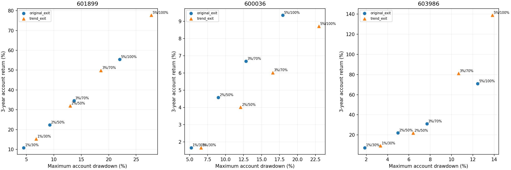

# 唐奇安策略：提高仓位与延长趋势持有的情景比较



研究日2026-10-19，历史窗口2023-10-18至2026-10-16，数据来自已归档快照；没有刷新当前行情。每股每方案独立10万元，不加杠杆，不是三股合并组合。三年收益以全部初始资金为分母，期末持仓按收盘估值且不强制卖出。

固定比较风险预算1%/2%/3%/5%与投入上限30%/50%/70%/100%的四个成对档位；档位同时改变风险和投入上限，不能分别归因。各档再对比原3R止盈+20日上限与取消盈利目标/期限的趋势退出；保持同一20日上穿事件入场、10日低点指标退出、初始2ATR/移动3ATR保护，不加仓，也未改变重新入场机制。

风险预算是开仓前账户资金乘比例，再按2ATR风险距离限股数，不代表实际最大亏损或账户最大回撤。高股价可能仍因100股取整或资金上限无法入场。收盘触发、次日开盘执行，跳空和跌停会扩大损失。资金占用和利润回吐需要同时看。

投入上限按每次开仓时的账户资金计算，盈利滚动投入；平均开仓金额可能超过最初10万元，但没有借款。被动基准按相同30%/50%/70%/100%资金上限起始买入并持有，100股取整后可低于上限，后续权重随价格漂移；它与动态风险限仓的暴露仍不同，需结合平均持仓解释。

成本沿用原佣金双边万2.5且最低5元、过户费双边十万分之一、卖出印花税万5、滑点双边万5；分红与红利税另计，空仓现金收益为0。保持A股T+1和涨跌停近似。

原方案通过与此前三股、三个时期的已存结果逐项核对；所有72组账户均核验现金、净资产、逐笔盈亏、资金与初始名义风险上限及整手规则。最后一年属于已参与研究的分段复查；最高收盘日仅作事后诊断，不是可预知卖点。不根据结果调整参数，也不将事后收益最高档位自动推荐为实盘配置。

## 紫金矿业

| 仓位方案 | 退出 | 三年收益 | 最大回撤 | 平均每次投入元 | 平均持仓 | 开仓/平仓 | 最后一年收益 | 最后一年开仓 | 股价最高收盘日账户收益 |
| --- | --- | --- | --- | --- | --- | --- | --- | --- | --- |
| 原方案 | 原短线退出 | 10.83% | -4.51% | 16700.28 | 4.76% | 14/14 | 1.92% | 3 | 11.88% |
| 原方案 | 趋势退出 | 15.21% | -6.78% | 18084.80 | 8.26% | 10/10 | 2.93% | 2 | 17.64% |
| 风险2%/投入上限50% | 原短线退出 | 22.36% | -9.26% | 36040.58 | 9.83% | 14/14 | 4.67% | 3 | 24.86% |
| 风险2%/投入上限50% | 趋势退出 | 31.98% | -12.98% | 38839.30 | 16.32% | 10/10 | 6.73% | 2 | 37.86% |
| 风险3%/投入上限70% | 原短线退出 | 34.61% | -13.70% | 56581.33 | 14.75% | 14/14 | 7.04% | 3 | 38.96% |
| 风险3%/投入上限70% | 趋势退出 | 49.86% | -18.59% | 61591.67 | 24.06% | 10/10 | 10.43% | 2 | 59.57% |
| 风险5%/投入上限100% | 原短线退出 | 55.38% | -22.01% | 98772.94 | 24.02% | 14/14 | 12.30% | 3 | 64.41% |
| 风险5%/投入上限100% | 趋势退出 | 77.76% | -27.75% | 107201.51 | 36.97% | 10/10 | 17.92% | 2 | 95.38% |

## 紫金矿业：买入持有基准

| 起始投入上限 | 被动持有三年收益 | 最大回撤 | 平均持仓 |
| --- | --- | --- | --- |
| 30.00% | 46.73% | -24.33% | 41.00% |
| 50.00% | 79.83% | -31.75% | 61.45% |
| 70.00% | 110.98% | -36.12% | 77.20% |
| 100.00% | 159.66% | -40.48% | 97.48% |

## 招商银行

| 仓位方案 | 退出 | 三年收益 | 最大回撤 | 平均每次投入元 | 平均持仓 | 开仓/平仓 | 最后一年收益 | 最后一年开仓 | 股价最高收盘日账户收益 |
| --- | --- | --- | --- | --- | --- | --- | --- | --- | --- |
| 原方案 | 原短线退出 | 1.66% | -5.21% | 26437.91 | 8.76% | 18/17 | -3.73% | 7 | 6.32% |
| 原方案 | 趋势退出 | 1.66% | -6.58% | 26267.23 | 10.95% | 14/13 | -3.71% | 6 | 6.77% |
| 风险2%/投入上限50% | 原短线退出 | 4.57% | -8.99% | 51368.57 | 16.64% | 18/17 | -6.68% | 7 | 13.12% |
| 风险2%/投入上限50% | 趋势退出 | 4.01% | -12.09% | 50957.13 | 20.81% | 14/13 | -6.53% | 6 | 14.14% |
| 风险3%/投入上限70% | 原短线退出 | 6.68% | -12.84% | 75888.97 | 23.64% | 18/17 | -9.31% | 7 | 19.42% |
| 风险3%/投入上限70% | 趋势退出 | 6.01% | -16.55% | 74026.86 | 29.18% | 14/13 | -9.03% | 6 | 20.75% |
| 风险5%/投入上限100% | 原短线退出 | 9.35% | -17.94% | 114083.14 | 33.92% | 18/17 | -13.17% | 7 | 28.56% |
| 风险5%/投入上限100% | 趋势退出 | 8.71% | -22.96% | 111953.23 | 42.08% | 14/13 | -13.10% | 6 | 31.49% |

## 招商银行：买入持有基准

| 起始投入上限 | 被动持有三年收益 | 最大回撤 | 平均持仓 |
| --- | --- | --- | --- |
| 30.00% | 14.33% | -7.55% | 31.73% |
| 50.00% | 23.88% | -11.53% | 50.61% |
| 70.00% | 33.44% | -14.89% | 68.05% |
| 100.00% | 47.77% | -19.06% | 92.06% |

## 兆易创新

| 仓位方案 | 退出 | 三年收益 | 最大回撤 | 平均每次投入元 | 平均持仓 | 开仓/平仓 | 最后一年收益 | 最后一年开仓 | 股价最高收盘日账户收益 |
| --- | --- | --- | --- | --- | --- | --- | --- | --- | --- |
| 原方案 | 原短线退出 | 7.34% | -1.85% | 10362.57 | 1.38% | 7/7 | 0.00% | 0 | 7.34% |
| 原方案 | 趋势退出 | 9.23% | -3.32% | 10362.57 | 2.89% | 7/7 | 0.00% | 0 | 9.23% |
| 风险2%/投入上限50% | 原短线退出 | 22.07% | -4.97% | 21182.13 | 4.76% | 12/12 | 5.94% | 1 | 22.07% |
| 风险2%/投入上限50% | 趋势退出 | 21.81% | -6.39% | 18442.68 | 7.04% | 10/10 | 4.64% | 1 | 21.81% |
| 风险3%/投入上限70% | 原短线退出 | 31.00% | -7.70% | 31586.60 | 8.18% | 15/15 | 9.36% | 4 | 31.00% |
| 风险3%/投入上限70% | 趋势退出 | 81.07% | -10.65% | 32300.35 | 14.35% | 11/11 | 39.01% | 3 | 97.90% |
| 风险5%/投入上限100% | 原短线退出 | 70.84% | -12.44% | 61021.93 | 16.39% | 17/17 | 30.15% | 5 | 87.67% |
| 风险5%/投入上限100% | 趋势退出 | 138.85% | -13.81% | 56280.01 | 22.33% | 11/11 | 43.66% | 3 | 172.51% |

## 兆易创新：买入持有基准

| 起始投入上限 | 被动持有三年收益 | 最大回撤 | 平均持仓 |
| --- | --- | --- | --- |
| 30.00% | 36.25% | -45.33% | 28.60% |
| 50.00% | 72.51% | -56.78% | 49.62% |
| 70.00% | 108.76% | -62.00% | 67.81% |
| 100.00% | 163.15% | -66.05% | 93.03% |

## 文件与复现

```bash
.venv/bin/python scripts/replay_aggressive_donchian.py
```

参数见 `config/aggressive_donchian.json`；`summary.csv`保留全部时期统计；`trades.csv`为已平仓记录；`entries.csv`包含期末未平仓的开仓金额；`account_paths.csv`为每日账户。

仓位与风险承受能力：[Investor.gov](https://www.investor.gov/introduction-investing/getting-started/asset-allocation)。本报告的数值档位为研究情景，不来自该来源的个人风险建议。
