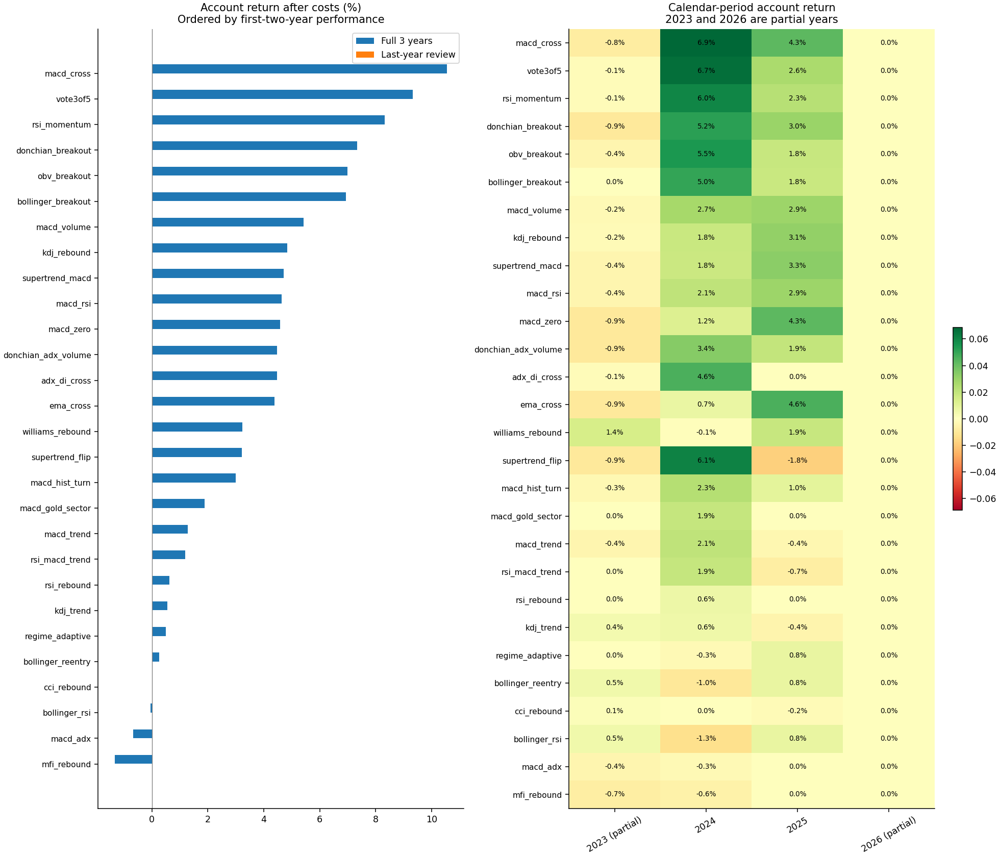
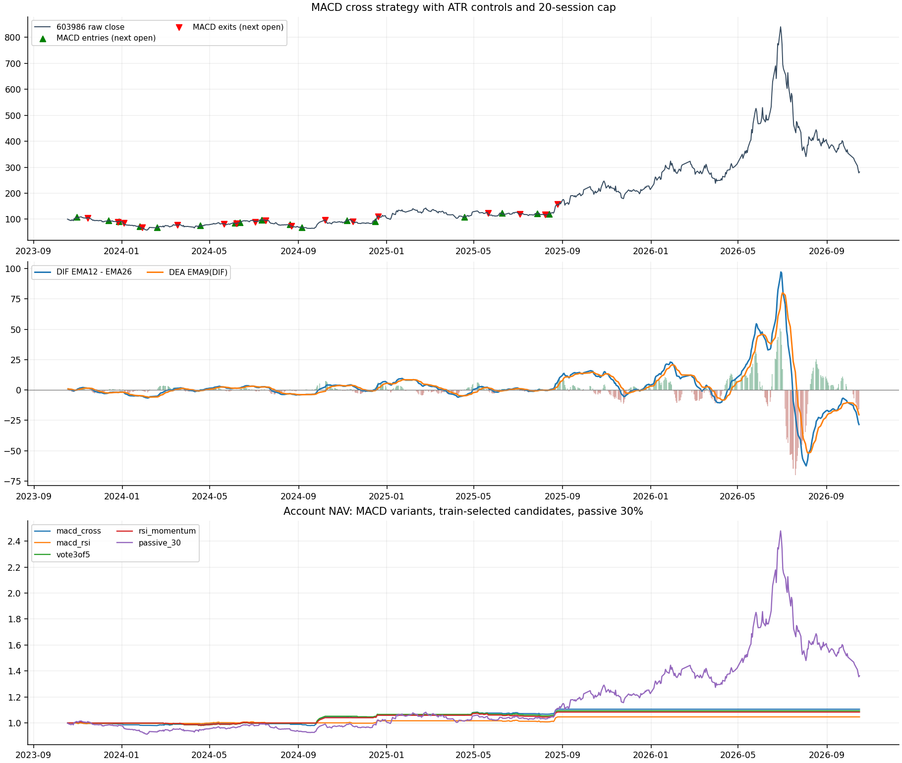

# 兆易创新三年多指标与混合规则探索





## 研究范围

回放 2023-10-18 至 2026-10-16 的兆易创新 A 股 603986 历史行情，共 726 个交易日，预热历史从 2023 年初开始。固定 28 个候选，其中 16 个单指标规则和 12 个混合规则，没有对阈值作网格寻优。初始账户 10 万元，只做多、不加杠杆。全部账户收益以初始10万元为分母，期末未平仓按收盘价估值并保留，不强制卖出。

## 比较口径

主比较使用指标自身退出，另叠加初始 2ATR 收盘止损、最高收盘价减 3ATR 的移动保护、3R 目标和最长 20 个交易日；去掉上轮统一的跌破 MA20 退出，除非某个规则自身要求该条件。对照比较使用同样入场、相同 ATR/时间规则，移除指标自身退出。所有交易都是收盘产生信号、次日开盘执行，遵守 T+1、100 股整数倍和涨跌停近似。

## 总体结果

28 个主比较候选中，三年账户收益为正的有 25 个，最后一年为正的有 0 个。三年事后最高收益的候选为“MACD 金叉”，收益 10.55%，平仓 17 笔；这是已做多次探索后的样本内排名，不能直接当作最优策略或未来成功率。完整表按前两年收益排序，所有失败结果也保留。

| 规则 | 类型 | 前两年收益 | 三年收益 | 三年回撤 | 平仓笔数 | 胜率 | 最后一年收益 | 最后一年笔数 | 平均持仓权重 |
| --- | --- | --- | --- | --- | --- | --- | --- | --- | --- |
| MACD 金叉 | 单指标 | 10.55% | 10.55% | -2.30% | 17 | 41.18% | 0.00% | 0 | 2.35% |
| 五项条件三票通过 | 混合 | 9.31% | 9.31% | -2.81% | 18 | 33.33% | 0.00% | 0 | 1.80% |
| RSI50 动量 | 单指标 | 8.32% | 8.32% | -2.74% | 16 | 37.50% | 0.00% | 0 | 1.78% |
| 唐奇安20日突破 | 单指标 | 7.34% | 7.34% | -1.85% | 7 | 57.14% | 0.00% | 0 | 1.38% |
| OBV 量能突破 | 单指标 | 6.98% | 6.98% | -2.31% | 12 | 41.67% | 0.00% | 0 | 1.34% |
| 布林上轨突破 | 单指标 | 6.93% | 6.93% | -2.02% | 9 | 44.44% | 0.00% | 0 | 0.93% |
| MACD＋放量 | 混合 | 5.41% | 5.41% | -1.17% | 10 | 50.00% | 0.00% | 0 | 1.55% |
| KDJ 低位金叉 | 单指标 | 4.84% | 4.84% | -3.01% | 21 | 38.10% | 0.00% | 0 | 1.69% |
| Supertrend＋MACD | 混合 | 4.71% | 4.71% | -0.83% | 7 | 42.86% | 0.00% | 0 | 0.77% |
| MACD＋RSI | 混合 | 4.63% | 4.63% | -1.18% | 10 | 40.00% | 0.00% | 0 | 1.38% |
| MACD 零轴突破 | 单指标 | 4.58% | 4.58% | -1.69% | 8 | 37.50% | 0.00% | 0 | 1.38% |
| 突破＋ADX＋放量 | 混合 | 4.47% | 4.47% | -2.32% | 6 | 50.00% | 0.00% | 0 | 0.95% |
| ADX 趋势金叉 | 单指标 | 4.47% | 4.47% | -1.70% | 5 | 20.00% | 0.00% | 0 | 0.56% |
| EMA10/30 金叉 | 单指标 | 4.38% | 4.38% | -2.01% | 7 | 42.86% | 0.00% | 0 | 1.34% |
| 威廉指标超卖回升 | 单指标 | 3.23% | 3.23% | -2.64% | 15 | 60.00% | 0.00% | 0 | 1.56% |
| Supertrend 翻多 | 单指标 | 3.21% | 3.21% | -2.27% | 8 | 50.00% | 0.00% | 0 | 1.28% |
| MACD 绿柱缩短拐点 | 单指标 | 2.99% | 2.99% | -2.95% | 15 | 53.33% | 0.00% | 0 | 2.08% |
| MACD＋黄金板块 | 混合 | 1.89% | 1.89% | -0.30% | 1 | 100.00% | 0.00% | 0 | 0.06% |
| MACD＋均线趋势 | 混合 | 1.28% | 1.28% | -1.09% | 8 | 37.50% | 0.00% | 0 | 1.10% |
| RSI50＋MACD＋均线 | 混合 | 1.19% | 1.19% | -0.87% | 5 | 40.00% | 0.00% | 0 | 0.57% |
| RSI30 超卖回升 | 单指标 | 0.62% | 0.62% | -1.93% | 5 | 40.00% | 0.00% | 0 | 0.53% |
| KDJ＋均线趋势 | 混合 | 0.55% | 0.55% | -1.80% | 8 | 37.50% | 0.00% | 0 | 0.75% |
| ADX 区分趋势与震荡 | 混合 | 0.50% | 0.50% | -0.70% | 2 | 50.00% | 0.00% | 0 | 0.19% |
| 布林下轨回归 | 单指标 | 0.25% | 0.25% | -1.58% | 7 | 71.43% | 0.00% | 0 | 0.69% |
| CCI 超卖回升 | 单指标 | 0.02% | 0.02% | -2.63% | 17 | 41.18% | 0.00% | 0 | 1.29% |
| 布林下轨＋RSI | 混合 | -0.05% | -0.05% | -1.58% | 6 | 66.67% | 0.00% | 0 | 0.68% |
| MACD＋ADX | 混合 | -0.67% | -0.67% | -0.70% | 2 | 0.00% | 0.00% | 0 | 0.24% |
| MFI 资金流回升 | 单指标 | -1.33% | -1.33% | -2.05% | 4 | 25.00% | 0.00% | 0 | 0.30% |

## MACD 单独与混合的表现

MACD 12/26/9 金叉规则在共同风控下，三年账户收益 10.55%、最大收盘回撤 -2.30%、平仓 17 笔、胜率 41.18%。其胜率 Wilson 参考区间为 21.61%～63.99%。以下列出全部含 MACD 的候选，便于比较均线、RSI、放量、ADX、黄金板块等附加条件是否改善样本结果。

| 规则 | 类型 | 前两年收益 | 三年收益 | 三年回撤 | 平仓笔数 | 胜率 | 最后一年收益 | 最后一年笔数 | 平均持仓权重 |
| --- | --- | --- | --- | --- | --- | --- | --- | --- | --- |
| MACD 金叉 | 单指标 | 10.55% | 10.55% | -2.30% | 17 | 41.18% | 0.00% | 0 | 2.35% |
| MACD＋放量 | 混合 | 5.41% | 5.41% | -1.17% | 10 | 50.00% | 0.00% | 0 | 1.55% |
| Supertrend＋MACD | 混合 | 4.71% | 4.71% | -0.83% | 7 | 42.86% | 0.00% | 0 | 0.77% |
| MACD＋RSI | 混合 | 4.63% | 4.63% | -1.18% | 10 | 40.00% | 0.00% | 0 | 1.38% |
| MACD 零轴突破 | 单指标 | 4.58% | 4.58% | -1.69% | 8 | 37.50% | 0.00% | 0 | 1.38% |
| MACD 绿柱缩短拐点 | 单指标 | 2.99% | 2.99% | -2.95% | 15 | 53.33% | 0.00% | 0 | 2.08% |
| MACD＋黄金板块 | 混合 | 1.89% | 1.89% | -0.30% | 1 | 100.00% | 0.00% | 0 | 0.06% |
| MACD＋均线趋势 | 混合 | 1.28% | 1.28% | -1.09% | 8 | 37.50% | 0.00% | 0 | 1.10% |
| RSI50＋MACD＋均线 | 混合 | 1.19% | 1.19% | -0.87% | 5 | 40.00% | 0.00% | 0 | 0.57% |
| MACD＋ADX | 混合 | -0.67% | -0.67% | -0.70% | 2 | 0.00% | 0.00% | 0 | 0.24% |

## 混合指标是否改善结果

逐一与基础规则比较，八组混合比较中三年账户收益增加的有 0 组，分别为：无。这些差异同时受交易次数、投入股数及个别大波段影响；添加条件会减少交易，不能将一次收益改善解释为新增指标具有独立预测能力。

| 基础规则 | 混合规则 | 基础三年收益 | 混合三年收益 | 三年收益变化百分点 | 基础最后一年 | 混合最后一年 | 混合平仓笔数 |
| --- | --- | --- | --- | --- | --- | --- | --- |
| MACD 金叉 | MACD＋均线趋势 | 10.55% | 1.28% | -9.28 | 0.00% | 0.00% | 8 |
| MACD 金叉 | MACD＋RSI | 10.55% | 4.63% | -5.92 | 0.00% | 0.00% | 10 |
| MACD 金叉 | MACD＋放量 | 10.55% | 5.41% | -5.14 | 0.00% | 0.00% | 10 |
| MACD 金叉 | MACD＋ADX | 10.55% | -0.67% | -11.22 | 0.00% | 0.00% | 2 |
| MACD 金叉 | MACD＋黄金板块 | 10.55% | 1.89% | -8.67 | 0.00% | 0.00% | 1 |
| KDJ 低位金叉 | KDJ＋均线趋势 | 4.84% | 0.55% | -4.29 | 0.00% | 0.00% | 8 |
| 布林下轨回归 | 布林下轨＋RSI | 0.25% | -0.05% | -0.30 | 0.00% | 0.00% | 6 |
| 唐奇安20日突破 | 突破＋ADX＋放量 | 7.34% | 4.47% | -2.87 | 0.00% | 0.00% | 6 |

## 高胜率与收益的区别

布林下轨回归主比较为 7 笔平仓中 5 笔盈利，胜率 71.43%，三年账户收益 0.25%，最后一年为 0.00%。本样本平均盈利约 384.66 元，平均亏损绝对值约 835.23 元。MACD 零轴经典对照的胜率为 38.46%，三年收益为 36.30%，且仓位更大、持有更久。这说明评估时需要同时看胜率、盈亏幅度、交易次数、资金暴露和分段表现。

## 退出方式的重要性

MACD 绿柱拐点信号使用原生退出时三年收益为 2.99%，改为仅共同风控后为 5.85%，对应回撤分别为 -2.95%、-3.73%；最后一年对应收益为 0.00%、0.00%。布林下轨回归使用达到中轨退出时收益为 0.25%，改为共同风控后为 1.10%。共同风控的保护和持有时间改变了盈亏分布，三年结果尚不能确认为稳定优势。

## 经典金叉买死叉卖对照

另做三组纯指标退出对照：取消 ATR 风险限仓、ATR 止损、移动保护、3R 目标及 20 日上限，仅在指标反向时退出，每次投入含成本最多占账户 30%。长持仓期间权重会漂移，平均资金暴露可能明显高于主比较；收益差异同时来自持仓时间、仓位和退出逻辑，不能仅归因于指标优劣。期末未平仓仅估值，不计入胜率。

| 规则 | 三年收益 | 三年回撤 | 平仓笔数 | 胜率 | 平均持有交易日 | 平均持仓权重 | 最后一年收益 | 期末未平仓 |
| --- | --- | --- | --- | --- | --- | --- | --- | --- |
| MACD 金叉 | 28.97% | -9.89% | 27 | 40.74% | 13.63 | 13.24% | 22.26% | 无 |
| MACD 零轴突破 | 36.30% | -21.85% | 13 | 38.46% | 29.62 | 15.29% | 19.33% | 无 |
| EMA10/30 金叉 | 33.63% | -22.19% | 12 | 41.67% | 32.17 | 15.54% | 18.16% | 无 |

## 仅按前两年挑选后的最后一年复查

先限定前两年至少平仓 8 笔，按前两年账户净收益选择前 3 个，选出：MACD 金叉、五项条件三票通过、RSI50 动量。然后在最后一年从空仓重新回放。规则源于此前紫金研究，同一日历窗口已参与历史探索；本轮完整查看所有标的和候选结果，将最后一年标为时间分段复查，不宣称独立未触碰样本外或已验证可交易优势。

| 规则 | 类型 | 前两年收益 | 三年收益 | 三年回撤 | 平仓笔数 | 胜率 | 最后一年收益 | 最后一年笔数 | 平均持仓权重 |
| --- | --- | --- | --- | --- | --- | --- | --- | --- | --- |
| MACD 金叉 | 单指标 | 10.55% | 10.55% | -2.30% | 17 | 41.18% | 0.00% | 0 | 2.35% |
| 五项条件三票通过 | 混合 | 9.31% | 9.31% | -2.81% | 18 | 33.33% | 0.00% | 0 | 1.80% |
| RSI50 动量 | 单指标 | 8.32% | 8.32% | -2.74% | 16 | 37.50% | 0.00% | 0 | 1.78% |

## 退出方式和参数敏感性

主比较中有 11 个候选的三年收益高于统一退出对照。下表另比较最长持仓改为 40 日、佣金和滑点翻倍，以及取消 1% ATR 风险限仓、改为仅使用 30% 入场资金上限的情况。固定投入对照仍保留 ATR 退出。敏感性结果用于理解规则依赖，不据此再挑选新的参数。

| 规则 | 主比较三年收益 | 统一退出收益 | 延至40日收益 | 佣金滑点翻倍 | 仅限30%投入收益 |
| --- | --- | --- | --- | --- | --- |
| MACD 金叉 | 10.55% | 9.66% | 9.25% | 10.21% | 36.94% |
| 五项条件三票通过 | 9.31% | 10.87% | 8.75% | 8.96% | 33.31% |
| RSI50 动量 | 8.32% | 10.69% | 7.76% | 8.00% | 37.53% |
| 唐奇安20日突破 | 7.34% | 9.23% | 6.55% | 7.19% | 20.79% |
| OBV 量能突破 | 6.98% | 6.54% | 6.98% | 6.73% | 30.63% |
| 布林上轨突破 | 6.93% | 8.23% | 6.93% | 7.68% | 16.04% |
| MACD＋放量 | 5.41% | 4.80% | 4.77% | 5.21% | 18.13% |
| KDJ 低位金叉 | 4.84% | 5.42% | 4.84% | 4.42% | 20.94% |
| Supertrend＋MACD | 4.71% | 4.47% | 4.71% | 4.56% | 9.03% |
| MACD＋RSI | 4.63% | 3.86% | 4.68% | 4.43% | 25.98% |
| MACD 零轴突破 | 4.58% | 4.99% | 5.89% | 4.41% | 21.56% |
| 突破＋ADX＋放量 | 4.47% | 6.71% | 3.67% | 4.34% | 0.94% |
| ADX 趋势金叉 | 4.47% | 6.70% | 4.47% | 4.37% | 13.14% |
| EMA10/30 金叉 | 4.38% | 4.78% | 5.69% | 4.23% | 19.72% |
| 威廉指标超卖回升 | 3.23% | 7.21% | 3.23% | 2.93% | 12.96% |
| Supertrend 翻多 | 3.21% | 3.21% | 3.78% | 3.05% | 23.89% |
| MACD 绿柱缩短拐点 | 2.99% | 5.85% | 2.99% | 2.69% | 16.19% |
| MACD＋黄金板块 | 1.89% | 1.89% | 1.89% | 1.87% | 12.55% |
| MACD＋均线趋势 | 1.28% | 0.19% | 1.32% | 1.12% | 1.12% |
| RSI50＋MACD＋均线 | 1.19% | 1.10% | 1.24% | 1.09% | 4.38% |
| RSI30 超卖回升 | 0.62% | 4.32% | 0.62% | 0.52% | 6.60% |
| KDJ＋均线趋势 | 0.55% | 1.14% | 0.55% | 0.39% | 2.34% |
| ADX 区分趋势与震荡 | 0.50% | -0.05% | 0.50% | 0.46% | 0.96% |
| 布林下轨回归 | 0.25% | 1.10% | 0.25% | 0.12% | 6.56% |
| CCI 超卖回升 | 0.02% | 4.74% | 0.02% | -0.31% | 5.98% |
| 布林下轨＋RSI | -0.05% | -0.57% | -0.05% | -0.16% | 3.13% |
| MACD＋ADX | -0.67% | -1.70% | -0.67% | -0.71% | -1.54% |
| MFI 资金流回升 | -1.33% | -1.46% | -1.33% | -1.40% | -3.81% |

## 资金与成本

主比较和统一退出对照都取 30% 入场资金上限与 1% 名义风险预算约束的较小者，风险距离为入场前的 2ATR14。空仓现金收益按零计算。佣金双边万 2.5、最低 5 元；过户费双边十万分之一；卖出印花税万 5；滑点成本双边万 5。分红和红利税单独记账。ATR 收盘止损不能保证实际亏损不超过预算，隔夜跳空和跌停延迟可能扩大损失。最大回撤仅按日收盘账户净值计算。

## 被动基准

同区间，起始按30%资金上限买入后持有不再平衡（100股取整后实际投入可能低于30%），账户收益 36.25%、回撤 -45.33%、平均持仓权重 28.60%；接近满仓被动持有收益 163.15%、回撤 -66.05%。波段候选平均权重见表；低回撤可能主要来自低暴露，不能据此宣称风险调整后优势。

## 指标公式与数据时点

MACD：DIF = EMA12 − EMA26，DEA = EMA9(DIF)，柱值 = 2×(DIF−DEA)。KDJ 使用 9 日 RSV、K/D 从 50 开始按 SMA(X,3,1) 递推，J=3K−2D。CCI20 使用典型价的平均绝对偏差；MFI14 使用典型价和成交股数；ADX14 使用 Wilder 指数平滑与方向移动；Supertrend 使用 ATR10、3 倍带宽和首次有效状态为多。不同平台的初始化方法可能产生细微差别。技术价格只加回截至当日已除息现金股息，日线回放从不回写未来分红。

## 探索结果的边界

胜率仅为扣费后盈利的已平仓交易比例，未平仓不参与；Wilson 区间的独立二项假设只作近似。28 个候选、两种退出和附加敏感性都使用同一股票和相同历史，存在多重尝试偏差，候选之间也不独立。MACD、均线、RSI 等共享价格信息，多票通过不等于多个独立证据。更可信的下一步是冻结少量规则，记录后续新增交易日的模拟执行，不继续在同一三年样本上追逐最高胜率。

## 全部入场和指标退出规则

下列指标退出仅在原生退出比较中启用；主比较中的共同 ATR 风控和时间上限仍然有效。信号是事件触发，需要发生上穿或下穿；止损退出后不会仅因状态仍为多头就自动重新买入。ADX 状态混合规则按当日 ADX 决定退出分支，未锁定入场时的状态。

| 规则 | 类型 | 入场 | 指标退出 |
| --- | --- | --- | --- |
| MACD 金叉 | 单指标 | DIF 上穿 DEA，参数 12/26/9 | DIF 下穿 DEA |
| MACD 零轴突破 | 单指标 | DIF 上穿零轴 | DIF 下穿零轴 |
| MACD 绿柱缩短拐点 | 单指标 | 柱值在零轴下方，由下降转为上升 | 柱值在零轴上方，由上升转为下降 |
| EMA10/30 金叉 | 单指标 | EMA10 上穿 EMA30 | EMA10 下穿 EMA30 |
| RSI30 超卖回升 | 单指标 | RSI14 上穿 30 | RSI14 ≥ 60 或下穿 25 |
| RSI50 动量 | 单指标 | RSI14 上穿 50 | RSI14 下穿 50 |
| KDJ 低位金叉 | 单指标 | K 上穿 D 且前日 K < 30，参数 9/3/3 | K 下穿 D |
| 布林下轨回归 | 单指标 | 收盘从下方重返布林下轨之上，参数 20/2 | 收盘达到布林中轨 |
| 布林上轨突破 | 单指标 | 收盘上穿布林上轨，参数 20/2 | 收盘跌破布林中轨 |
| 唐奇安20日突破 | 单指标 | 收盘上穿此前 20 日最高价 | 收盘跌破此前 10 日最低价 |
| CCI 超卖回升 | 单指标 | CCI20 上穿 −100 | CCI20 ≥ 100 或下穿 −100 |
| MFI 资金流回升 | 单指标 | MFI14 上穿 20 | MFI14 ≥ 70 |
| OBV 量能突破 | 单指标 | OBV 上穿此前 20 日最高 OBV 且收盘 > MA20 | OBV < 其 EMA20 或收盘 < MA20 |
| ADX 趋势金叉 | 单指标 | +DI 上穿 −DI 且 ADX14 > 20 | +DI 下穿 −DI |
| Supertrend 翻多 | 单指标 | Supertrend(10,3) 从空翻多 | Supertrend 从多翻空 |
| 威廉指标超卖回升 | 单指标 | Williams %R14 上穿 −80 | Williams %R14 ≥ −20 |
| MACD＋均线趋势 | 混合 | MACD 金叉且 MA20 > MA60、收盘 > MA60 | MACD 死叉 |
| MACD＋RSI | 混合 | MACD 金叉且 RSI14 位于 45～70 | MACD 死叉 |
| MACD＋放量 | 混合 | MACD 金叉且量比 ≥ 1.2（基于此前 20 日均量） | MACD 死叉 |
| MACD＋ADX | 混合 | MACD 金叉且 ADX14 > 20、+DI > −DI | MACD 死叉或 +DI < −DI |
| MACD＋黄金板块 | 混合 | MACD 金叉且通过既有黄金与板块过滤 | MACD 死叉 |
| RSI50＋MACD＋均线 | 混合 | RSI14 上穿 50、DIF > DEA、通过均线趋势 | RSI14 下穿 50 或 MACD 死叉 |
| KDJ＋均线趋势 | 混合 | K 上穿 D、前日 K < 50、通过均线趋势 | K 下穿 D |
| 布林下轨＋RSI | 混合 | 收盘重返下轨之上且 RSI14 < 45 | 收盘达到中轨 |
| 突破＋ADX＋放量 | 混合 | 20 日突破、ADX14 > 20、+DI > −DI、量比 ≥ 1.2 | 收盘跌破此前 10 日最低价 |
| Supertrend＋MACD | 混合 | MACD 金叉且 Supertrend 状态为多 | Supertrend 翻空或 MACD 死叉 |
| ADX 区分趋势与震荡 | 混合 | ADX≥25 时 MACD 金叉且+DI>−DI；ADX<20 时布林回归且RSI<45；中间区不入场 | 当前 ADX≥25 时 MACD 死叉；当前 ADX<25 时收盘达到 MA20 |
| 五项条件三票通过 | 混合 | 收盘>MA60、MACD多头、RSI50～70、ADX多头、OBV>EMA20，满足数从<3升至≥3 | 上述条件满足数降至 ≤2 |

## 跨标的复用与数据来源

27条技术规则直接复用；MACD＋黄金板块仍使用原上海金Au99.99及申万贵金属801053过滤，未替换为银行或半导体行业指数，这一条应作为原规则照搬实验解释。股票与分红为2026-10-19联网取得的腾讯、新浪快照；黄金、贵金属、沪指复用原紫金研究缓存，抓取时间以原清单为准。贵金属2026-10-15缺失时依赖该条件的入场关闭，未填造数据。两只股票分别使用独立10万元，结果不能直接相加为组合收益。股价较高时100股取整和1%风险预算可能导致无法入场。

## 100股最小交易单位与风险预算

最后一年共241个交易日。按入场前2ATR计算，100股的名义风险范围为1935.39～11758.31元，其中241天高于期初10万元账户的1000元预算。28个主规则在该复查段合计平仓0笔，期末持仓0个。若整段无法开仓，0%收益体现的是仓位约束，不能据此评价该年度信号盈利能力；请并列查看预设的仅限30%投入敏感性，后者仍有ATR退出，但承担更高名义风险。

## 文件和复现

在仓库根目录运行：

```bash
.venv/bin/python scripts/explore_zijin_indicators.py --stock gigadevice
```

`leaderboard.csv` 保留全部候选数值；`results.json` 保存所有退出和敏感性结果；`trades.csv` 保存逐笔交易；`account_paths.csv` 保存每日账户；`features_and_signals.csv` 保存全部指标和每日入场/退出信号；`train_selection.json` 保存前两年挑选逻辑。

## 参考来源

- [Fidelity MACD 定义与 12/26/9 参数](https://www.fidelity.com/learning-center/trading-investing/technical-analysis/technical-indicator-guide/macd)
- [Fidelity ADX 趋势强度说明](https://www.fidelity.com/viewpoints/active-investor/average-directional-index-ADX)
- [Fidelity CCI 定义](https://www.fidelity.com/learning-center/trading-investing/technical-analysis/technical-indicator-guide/cci)
- [Fidelity MFI 定义](https://www.fidelity.com/learning-center/trading-investing/technical-analysis/technical-indicator-guide/mfi)
- [原始数据与来源](../../../data/gigadevice/README.md)
