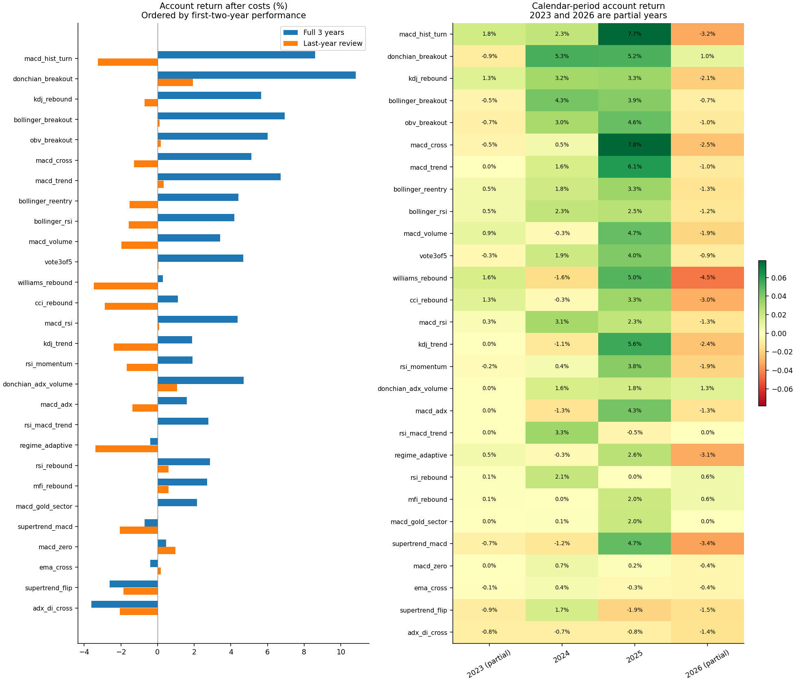
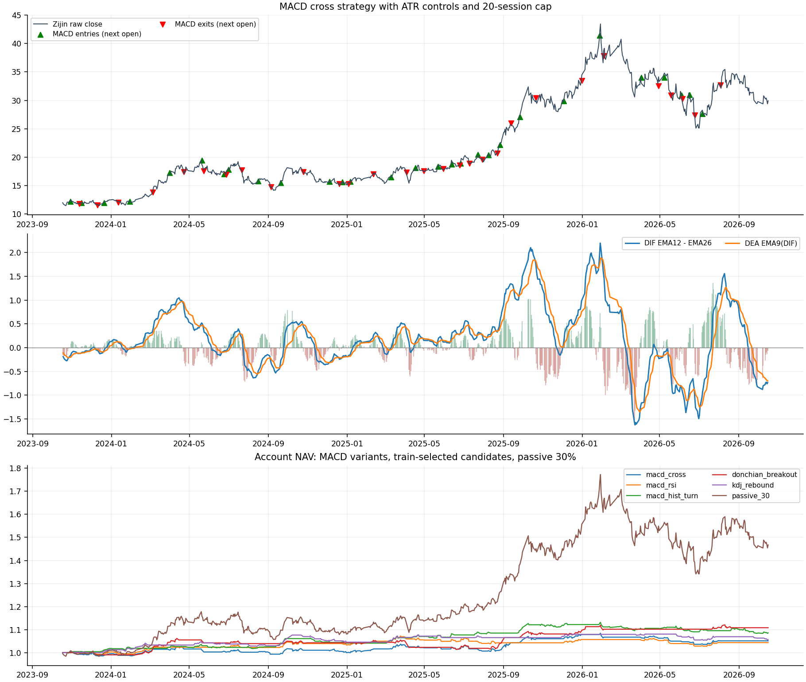

# 紫金矿业三年多指标与混合规则探索





## 研究范围

延用 2023-10-18 至 2026-10-16 的紫金矿业 A 股真实行情，共 726 个交易日，预热历史从 2023 年初开始。固定 28 个候选，其中 16 个单指标规则和 12 个混合规则，没有对阈值作网格寻优。初始账户 10 万元，只做多、不加杠杆。

## 比较口径

主比较使用指标自身退出，另叠加初始 2ATR 收盘止损、最高收盘价减 3ATR 的移动保护、3R 目标和最长 20 个交易日；去掉上轮统一的跌破 MA20 退出，除非某个规则自身要求该条件。对照比较使用同样入场、相同 ATR/时间规则，移除指标自身退出。所有交易都是收盘产生信号、次日开盘执行，遵守 T+1、100 股整数倍和涨跌停近似。

## 总体结果

28 个主比较候选中，三年账户收益为正的有 23 个，最后一年为正的有 11 个。三年事后最高收益的候选为“唐奇安20日突破”，收益 10.83%，平仓 14 笔；这是已做多次探索后的样本内排名，不能直接当作最优策略或未来成功率。完整表按前两年收益排序，所有失败结果也保留。

| 规则 | 类型 | 前两年收益 | 三年收益 | 三年回撤 | 平仓笔数 | 胜率 | 最后一年收益 | 最后一年笔数 | 平均持仓权重 |
| --- | --- | --- | --- | --- | --- | --- | --- | --- | --- |
| MACD 绿柱缩短拐点 | 单指标 | 12.11% | 8.59% | -4.23% | 29 | 58.62% | -3.25% | 10 | 5.90% |
| 唐奇安20日突破 | 单指标 | 8.15% | 10.83% | -4.51% | 14 | 57.14% | 1.92% | 3 | 4.76% |
| KDJ 低位金叉 | 单指标 | 6.53% | 5.65% | -2.92% | 27 | 44.44% | -0.71% | 8 | 4.25% |
| 布林上轨突破 | 单指标 | 6.27% | 6.95% | -5.38% | 15 | 46.67% | 0.10% | 3 | 4.46% |
| OBV 量能突破 | 单指标 | 6.04% | 6.01% | -4.10% | 30 | 33.33% | 0.19% | 9 | 6.05% |
| MACD 金叉 | 单指标 | 5.96% | 5.13% | -4.51% | 29 | 41.38% | -1.28% | 7 | 7.47% |
| MACD＋均线趋势 | 混合 | 5.94% | 6.72% | -3.36% | 14 | 57.14% | 0.33% | 2 | 3.78% |
| 布林下轨回归 | 单指标 | 5.62% | 4.43% | -2.73% | 14 | 85.71% | -1.53% | 6 | 2.10% |
| 布林下轨＋RSI | 混合 | 5.43% | 4.19% | -2.70% | 12 | 83.33% | -1.57% | 5 | 1.75% |
| MACD＋放量 | 混合 | 5.30% | 3.41% | -4.30% | 12 | 50.00% | -1.98% | 4 | 2.72% |
| 五项条件三票通过 | 混合 | 4.72% | 4.67% | -4.50% | 38 | 26.32% | 0.05% | 10 | 6.51% |
| 威廉指标超卖回升 | 单指标 | 4.46% | 0.30% | -4.88% | 25 | 68.00% | -3.49% | 8 | 4.13% |
| CCI 超卖回升 | 单指标 | 4.34% | 1.10% | -3.88% | 27 | 44.44% | -2.89% | 9 | 3.27% |
| MACD＋RSI | 混合 | 4.29% | 4.37% | -4.16% | 20 | 45.00% | 0.08% | 5 | 5.67% |
| KDJ＋均线趋势 | 混合 | 4.21% | 1.89% | -3.28% | 19 | 42.11% | -2.38% | 7 | 2.55% |
| RSI50 动量 | 单指标 | 3.82% | 1.92% | -4.03% | 44 | 29.55% | -1.69% | 14 | 6.46% |
| 突破＋ADX＋放量 | 混合 | 3.30% | 4.71% | -6.27% | 11 | 45.45% | 1.07% | 3 | 2.96% |
| MACD＋ADX | 混合 | 2.86% | 1.59% | -2.82% | 8 | 37.50% | -1.36% | 2 | 1.21% |
| RSI50＋MACD＋均线 | 混合 | 2.77% | 2.77% | -0.82% | 3 | 33.33% | 0.00% | 0 | 0.65% |
| ADX 区分趋势与震荡 | 混合 | 2.71% | -0.40% | -4.85% | 10 | 60.00% | -3.39% | 4 | 1.51% |
| RSI30 超卖回升 | 单指标 | 2.27% | 2.86% | -1.06% | 4 | 100.00% | 0.59% | 1 | 1.22% |
| MFI 资金流回升 | 单指标 | 2.12% | 2.71% | -1.05% | 3 | 100.00% | 0.59% | 1 | 1.06% |
| MACD＋黄金板块 | 混合 | 2.05% | 2.15% | -1.40% | 4 | 100.00% | 0.00% | 0 | 1.10% |
| Supertrend＋MACD | 混合 | 1.25% | -0.71% | -4.43% | 15 | 40.00% | -2.05% | 4 | 3.26% |
| MACD 零轴突破 | 单指标 | -0.52% | 0.46% | -3.44% | 11 | 36.36% | 0.98% | 3 | 3.73% |
| EMA10/30 金叉 | 单指标 | -0.59% | -0.40% | -3.71% | 12 | 33.33% | 0.19% | 3 | 3.77% |
| Supertrend 翻多 | 单指标 | -1.17% | -2.60% | -5.57% | 11 | 36.36% | -1.85% | 3 | 3.80% |
| ADX 趋势金叉 | 单指标 | -1.56% | -3.61% | -3.65% | 10 | 0.00% | -2.05% | 5 | 1.00% |

## MACD 单独与混合的表现

MACD 12/26/9 金叉规则在共同风控下，三年账户收益 5.13%、最大收盘回撤 -4.51%、平仓 29 笔、胜率 41.38%。其胜率 Wilson 参考区间为 25.51%～59.26%。以下列出全部含 MACD 的候选，便于比较均线、RSI、放量、ADX、黄金板块等附加条件是否改善样本结果。

| 规则 | 类型 | 前两年收益 | 三年收益 | 三年回撤 | 平仓笔数 | 胜率 | 最后一年收益 | 最后一年笔数 | 平均持仓权重 |
| --- | --- | --- | --- | --- | --- | --- | --- | --- | --- |
| MACD 绿柱缩短拐点 | 单指标 | 12.11% | 8.59% | -4.23% | 29 | 58.62% | -3.25% | 10 | 5.90% |
| MACD 金叉 | 单指标 | 5.96% | 5.13% | -4.51% | 29 | 41.38% | -1.28% | 7 | 7.47% |
| MACD＋均线趋势 | 混合 | 5.94% | 6.72% | -3.36% | 14 | 57.14% | 0.33% | 2 | 3.78% |
| MACD＋放量 | 混合 | 5.30% | 3.41% | -4.30% | 12 | 50.00% | -1.98% | 4 | 2.72% |
| MACD＋RSI | 混合 | 4.29% | 4.37% | -4.16% | 20 | 45.00% | 0.08% | 5 | 5.67% |
| MACD＋ADX | 混合 | 2.86% | 1.59% | -2.82% | 8 | 37.50% | -1.36% | 2 | 1.21% |
| RSI50＋MACD＋均线 | 混合 | 2.77% | 2.77% | -0.82% | 3 | 33.33% | 0.00% | 0 | 0.65% |
| MACD＋黄金板块 | 混合 | 2.05% | 2.15% | -1.40% | 4 | 100.00% | 0.00% | 0 | 1.10% |
| Supertrend＋MACD | 混合 | 1.25% | -0.71% | -4.43% | 15 | 40.00% | -2.05% | 4 | 3.26% |
| MACD 零轴突破 | 单指标 | -0.52% | 0.46% | -3.44% | 11 | 36.36% | 0.98% | 3 | 3.73% |

## 混合指标是否改善结果

逐一与基础规则比较，八组混合比较中三年账户收益增加的有 1 组，分别为：MACD＋均线趋势。这些差异同时受交易次数、投入股数及个别大波段影响；添加条件会减少交易，不能将一次收益改善解释为新增指标具有独立预测能力。

| 基础规则 | 混合规则 | 基础三年收益 | 混合三年收益 | 三年收益变化百分点 | 基础最后一年 | 混合最后一年 | 混合平仓笔数 |
| --- | --- | --- | --- | --- | --- | --- | --- |
| MACD 金叉 | MACD＋均线趋势 | 5.13% | 6.72% | +1.59 | -1.28% | 0.33% | 14 |
| MACD 金叉 | MACD＋RSI | 5.13% | 4.37% | -0.76 | -1.28% | 0.08% | 20 |
| MACD 金叉 | MACD＋放量 | 5.13% | 3.41% | -1.72 | -1.28% | -1.98% | 12 |
| MACD 金叉 | MACD＋ADX | 5.13% | 1.59% | -3.54 | -1.28% | -1.36% | 8 |
| MACD 金叉 | MACD＋黄金板块 | 5.13% | 2.15% | -2.98 | -1.28% | 0.00% | 4 |
| KDJ 低位金叉 | KDJ＋均线趋势 | 5.65% | 1.89% | -3.76 | -0.71% | -2.38% | 19 |
| 布林下轨回归 | 布林下轨＋RSI | 4.43% | 4.19% | -0.23 | -1.53% | -1.57% | 12 |
| 唐奇安20日突破 | 突破＋ADX＋放量 | 10.83% | 4.71% | -6.12 | 1.92% | 1.07% | 11 |

## 高胜率与收益的区别

布林下轨回归主比较为 14 笔平仓中 12 笔盈利，胜率 85.71%，三年账户收益 4.43%，最后一年为 -1.53%。本样本平均盈利约 666.69 元，平均亏损绝对值约 1405.65 元。MACD 零轴经典对照的胜率为 36.36%，三年收益为 31.12%，且仓位更大、持有更久。这说明评估时需要同时看胜率、盈亏幅度、交易次数、资金暴露和分段表现。

## 退出方式的重要性

MACD 绿柱拐点信号使用原生退出时三年收益为 8.59%，改为仅共同风控后为 17.44%，对应回撤分别为 -4.23%、-5.48%；最后一年对应收益为 -3.25%、-2.37%。布林下轨回归使用达到中轨退出时收益为 4.43%，改为共同风控后为 12.32%。共同风控的保护和持有时间改变了盈亏分布，三年结果尚不能确认为稳定优势。

## 经典金叉买死叉卖对照

另做三组纯指标退出对照：取消 ATR 风险限仓、ATR 止损、移动保护、3R 目标及 20 日上限，仅在指标反向时退出，每次投入含成本最多占账户 30%。长持仓期间权重会漂移，平均资金暴露可能明显高于主比较；收益差异同时来自持仓时间、仓位和退出逻辑，不能仅归因于指标优劣。期末未平仓仅估值，不计入胜率。

| 规则 | 三年收益 | 三年回撤 | 平仓笔数 | 胜率 | 平均持有交易日 | 平均持仓权重 | 最后一年收益 | 期末未平仓 |
| --- | --- | --- | --- | --- | --- | --- | --- | --- |
| MACD 金叉 | 10.00% | -12.31% | 29 | 41.38% | 13.24 | 16.00% | 0.22% | 无 |
| MACD 零轴突破 | 31.12% | -11.74% | 11 | 36.36% | 40.27 | 19.86% | 6.82% | 无 |
| EMA10/30 金叉 | 29.37% | -12.00% | 12 | 33.33% | 37.00 | 20.16% | 6.77% | 无 |

## 仅按前两年挑选后的最后一年复查

先限定前两年至少平仓 8 笔，按前两年账户净收益选择前 3 个，选出：MACD 绿柱缩短拐点、唐奇安20日突破、KDJ 低位金叉。然后在最后一年从空仓重新回放。最后一年已在上轮研究中看过，候选本身也由当前研究人员设计，因此这里是时间分段复查，不能宣称独立未触碰样本外或已验证可交易优势。

| 规则 | 类型 | 前两年收益 | 三年收益 | 三年回撤 | 平仓笔数 | 胜率 | 最后一年收益 | 最后一年笔数 | 平均持仓权重 |
| --- | --- | --- | --- | --- | --- | --- | --- | --- | --- |
| MACD 绿柱缩短拐点 | 单指标 | 12.11% | 8.59% | -4.23% | 29 | 58.62% | -3.25% | 10 | 5.90% |
| 唐奇安20日突破 | 单指标 | 8.15% | 10.83% | -4.51% | 14 | 57.14% | 1.92% | 3 | 4.76% |
| KDJ 低位金叉 | 单指标 | 6.53% | 5.65% | -2.92% | 27 | 44.44% | -0.71% | 8 | 4.25% |

## 退出方式和参数敏感性

主比较中有 11 个候选的三年收益高于统一退出对照。下表另比较最长持仓改为 40 日、佣金和滑点翻倍，以及取消 1% ATR 风险限仓、改为仅使用 30% 入场资金上限的情况。固定投入对照仍保留 ATR 退出。敏感性结果用于理解规则依赖，不据此再挑选新的参数。

| 规则 | 主比较三年收益 | 统一退出收益 | 延至40日收益 | 佣金滑点翻倍 | 仅限30%投入收益 |
| --- | --- | --- | --- | --- | --- |
| MACD 绿柱缩短拐点 | 8.59% | 17.44% | 8.53% | 7.76% | 11.15% |
| 唐奇安20日突破 | 10.83% | 10.15% | 8.54% | 10.45% | 16.85% |
| KDJ 低位金叉 | 5.65% | 10.15% | 5.65% | 4.97% | 9.80% |
| 布林上轨突破 | 6.95% | 6.54% | 7.26% | 6.54% | 10.10% |
| OBV 量能突破 | 6.01% | 2.01% | 5.65% | 5.22% | 8.88% |
| MACD 金叉 | 5.13% | 3.79% | 6.95% | 4.00% | 7.07% |
| MACD＋均线趋势 | 6.72% | 4.34% | 9.65% | 5.95% | 9.43% |
| 布林下轨回归 | 4.43% | 12.32% | 4.43% | 4.08% | 9.30% |
| 布林下轨＋RSI | 4.19% | 10.90% | 4.19% | 3.90% | 8.81% |
| MACD＋放量 | 3.41% | 2.91% | 2.36% | 3.11% | 6.04% |
| 五项条件三票通过 | 4.67% | -4.14% | 4.99% | 3.69% | 8.27% |
| 威廉指标超卖回升 | 0.30% | 7.29% | 0.03% | -0.34% | -1.96% |
| CCI 超卖回升 | 1.10% | 6.52% | 1.37% | 0.30% | -2.09% |
| MACD＋RSI | 4.37% | 6.56% | 6.03% | 3.83% | 8.55% |
| KDJ＋均线趋势 | 1.89% | 6.94% | 1.89% | 1.15% | 0.66% |
| RSI50 动量 | 1.92% | -5.14% | 2.95% | 0.90% | 0.64% |
| 突破＋ADX＋放量 | 4.71% | 4.71% | 3.98% | 4.05% | 4.14% |
| MACD＋ADX | 1.59% | 6.36% | 1.59% | 1.40% | 1.41% |
| RSI50＋MACD＋均线 | 2.77% | 3.92% | 2.77% | 2.68% | 4.15% |
| ADX 区分趋势与震荡 | -0.40% | 2.79% | -0.40% | -0.99% | -2.05% |
| RSI30 超卖回升 | 2.86% | 5.58% | -0.69% | 2.77% | 6.43% |
| MFI 资金流回升 | 2.71% | 2.69% | 0.43% | 2.63% | 5.24% |
| MACD＋黄金板块 | 2.15% | 5.88% | 2.15% | 2.03% | 4.41% |
| Supertrend＋MACD | -0.71% | -0.12% | 0.94% | -1.10% | -3.16% |
| MACD 零轴突破 | 0.46% | -0.02% | 1.47% | 0.17% | 1.01% |
| EMA10/30 金叉 | -0.40% | -0.41% | 1.39% | -0.72% | -0.80% |
| Supertrend 翻多 | -2.60% | -2.60% | -3.22% | -2.88% | -6.05% |
| ADX 趋势金叉 | -3.61% | 0.13% | -3.61% | -3.83% | -8.82% |

## 资金与成本

主比较和统一退出对照都取 30% 入场资金上限与 1% 名义风险预算约束的较小者，风险距离为入场前的 2ATR14。空仓现金收益按零计算。佣金双边万 2.5、最低 5 元；过户费双边十万分之一；卖出印花税万 5；滑点成本双边万 5。分红和红利税单独记账。ATR 收盘止损不能保证实际亏损不超过预算，隔夜跳空和跌停延迟可能扩大损失。最大回撤仅按日收盘账户净值计算。

## 被动基准

同区间，起始投入 30% 后持有不再平衡，账户收益 46.73%、回撤 -24.33%、平均持仓权重 41.00%；接近满仓被动持有收益 159.66%、回撤 -40.48%。波段候选平均权重见表；低回撤可能主要来自低暴露，不能据此宣称风险调整后优势。

## 指标公式与数据时点

MACD：DIF = EMA12 − EMA26，DEA = EMA9(DIF)，柱值 = 2×(DIF−DEA)。KDJ 使用 9 日 RSV、K/D 从 50 开始按 SMA(X,3,1) 递推，J=3K−2D。CCI20 使用典型价的平均绝对偏差；MFI14 使用典型价和成交股数；ADX14 使用 Wilder 指数平滑与方向移动；Supertrend 使用 ATR10、3 倍带宽和首次有效状态为多。不同平台的初始化方法可能产生细微差别。技术价格只加回截至当日已除息现金股息，日线回放从不回写未来分红。

## 探索结果的边界

胜率仅为扣费后盈利的已平仓交易比例，未平仓不参与；Wilson 区间的独立二项假设只作近似。28 个候选、两种退出和附加敏感性都使用同一股票和相同历史，存在多重尝试偏差，候选之间也不独立。MACD、均线、RSI 等共享价格信息，多票通过不等于多个独立证据。更可信的下一步是冻结少量规则，记录后续新增交易日的模拟执行，不继续在同一三年样本上追逐最高胜率。

## 全部入场和指标退出规则

下列指标退出仅在原生退出比较中启用；主比较中的共同 ATR 风控和时间上限仍然有效。信号是事件触发，需要发生上穿或下穿；止损退出后不会仅因状态仍为多头就自动重新买入。ADX 状态混合规则按当日 ADX 决定退出分支，未锁定入场时的状态。

| 规则 | 类型 | 入场 | 指标退出 |
| --- | --- | --- | --- |
| MACD 金叉 | 单指标 | DIF 上穿 DEA，参数 12/26/9 | DIF 下穿 DEA |
| MACD 零轴突破 | 单指标 | DIF 上穿零轴 | DIF 下穿零轴 |
| MACD 绿柱缩短拐点 | 单指标 | 柱值在零轴下方，由下降转为上升 | 柱值在零轴上方，由上升转为下降 |
| EMA10/30 金叉 | 单指标 | EMA10 上穿 EMA30 | EMA10 下穿 EMA30 |
| RSI30 超卖回升 | 单指标 | RSI14 上穿 30 | RSI14 ≥ 60 或下穿 25 |
| RSI50 动量 | 单指标 | RSI14 上穿 50 | RSI14 下穿 50 |
| KDJ 低位金叉 | 单指标 | K 上穿 D 且前日 K < 30，参数 9/3/3 | K 下穿 D |
| 布林下轨回归 | 单指标 | 收盘从下方重返布林下轨之上，参数 20/2 | 收盘达到布林中轨 |
| 布林上轨突破 | 单指标 | 收盘上穿布林上轨，参数 20/2 | 收盘跌破布林中轨 |
| 唐奇安20日突破 | 单指标 | 收盘上穿此前 20 日最高价 | 收盘跌破此前 10 日最低价 |
| CCI 超卖回升 | 单指标 | CCI20 上穿 −100 | CCI20 ≥ 100 或下穿 −100 |
| MFI 资金流回升 | 单指标 | MFI14 上穿 20 | MFI14 ≥ 70 |
| OBV 量能突破 | 单指标 | OBV 上穿此前 20 日最高 OBV 且收盘 > MA20 | OBV < 其 EMA20 或收盘 < MA20 |
| ADX 趋势金叉 | 单指标 | +DI 上穿 −DI 且 ADX14 > 20 | +DI 下穿 −DI |
| Supertrend 翻多 | 单指标 | Supertrend(10,3) 从空翻多 | Supertrend 从多翻空 |
| 威廉指标超卖回升 | 单指标 | Williams %R14 上穿 −80 | Williams %R14 ≥ −20 |
| MACD＋均线趋势 | 混合 | MACD 金叉且 MA20 > MA60、收盘 > MA60 | MACD 死叉 |
| MACD＋RSI | 混合 | MACD 金叉且 RSI14 位于 45～70 | MACD 死叉 |
| MACD＋放量 | 混合 | MACD 金叉且量比 ≥ 1.2（基于此前 20 日均量） | MACD 死叉 |
| MACD＋ADX | 混合 | MACD 金叉且 ADX14 > 20、+DI > −DI | MACD 死叉或 +DI < −DI |
| MACD＋黄金板块 | 混合 | MACD 金叉且通过既有黄金与板块过滤 | MACD 死叉 |
| RSI50＋MACD＋均线 | 混合 | RSI14 上穿 50、DIF > DEA、通过均线趋势 | RSI14 下穿 50 或 MACD 死叉 |
| KDJ＋均线趋势 | 混合 | K 上穿 D、前日 K < 50、通过均线趋势 | K 下穿 D |
| 布林下轨＋RSI | 混合 | 收盘重返下轨之上且 RSI14 < 45 | 收盘达到中轨 |
| 突破＋ADX＋放量 | 混合 | 20 日突破、ADX14 > 20、+DI > −DI、量比 ≥ 1.2 | 收盘跌破此前 10 日最低价 |
| Supertrend＋MACD | 混合 | MACD 金叉且 Supertrend 状态为多 | Supertrend 翻空或 MACD 死叉 |
| ADX 区分趋势与震荡 | 混合 | ADX≥25 时 MACD 金叉且+DI>−DI；ADX<20 时布林回归且RSI<45；中间区不入场 | 当前 ADX≥25 时 MACD 死叉；当前 ADX<25 时收盘达到 MA20 |
| 五项条件三票通过 | 混合 | 收盘>MA60、MACD多头、RSI50～70、ADX多头、OBV>EMA20，满足数从<3升至≥3 | 上述条件满足数降至 ≤2 |

## 文件和复现

在仓库根目录运行：

```bash
.venv/bin/python scripts/explore_zijin_indicators.py
```

`leaderboard.csv` 保留全部候选数值；`results.json` 保存所有退出和敏感性结果；`trades.csv` 保存逐笔交易；`account_paths.csv` 保存每日账户；`features_and_signals.csv` 保存全部指标和每日入场/退出信号；`train_selection.json` 保存前两年挑选逻辑。

## 参考来源

- [Fidelity MACD 定义与 12/26/9 参数](https://www.fidelity.com/learning-center/trading-investing/technical-analysis/technical-indicator-guide/macd)
- [Fidelity ADX 趋势强度说明](https://www.fidelity.com/viewpoints/active-investor/average-directional-index-ADX)
- [Fidelity CCI 定义](https://www.fidelity.com/learning-center/trading-investing/technical-analysis/technical-indicator-guide/cci)
- [Fidelity MFI 定义](https://www.fidelity.com/learning-center/trading-investing/technical-analysis/technical-indicator-guide/mfi)
- [原始数据与来源](../../../data/zijin/README.md)
