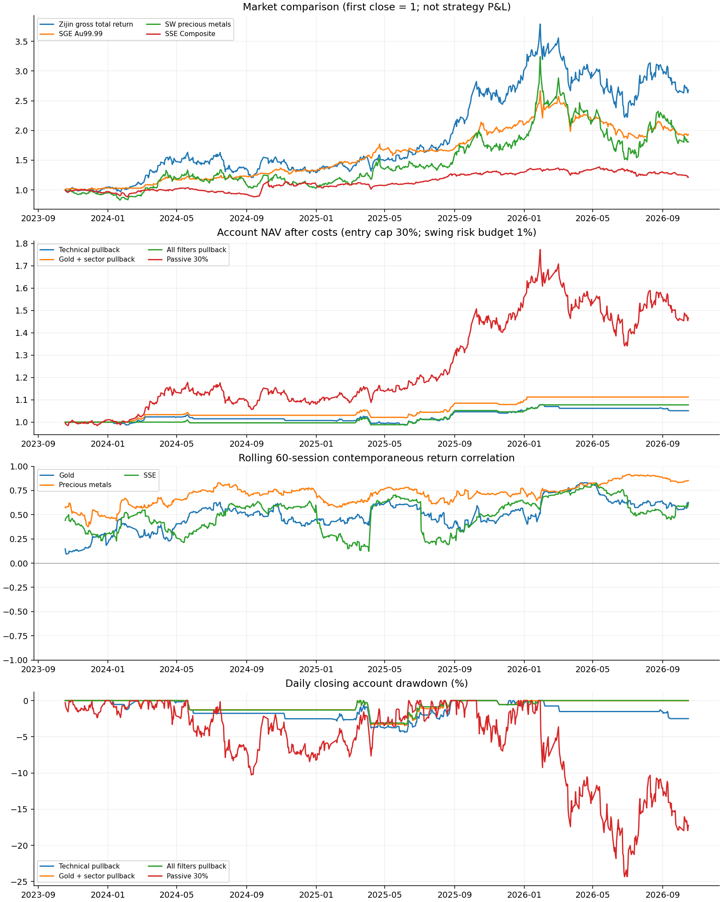

# 紫金矿业 A 股三年波段交易回放



## 范围与结论

研究日为 2026-10-18，完整回放区间为 2023-10-18 至 2026-10-16，共 726 个紫金交易日。研究标的是紫金矿业 A 股 601899，不是港股。下载自 2023-01-03 起的行情用于指标预热。全部数值来自本地真实数据快照。

## 关联程度

紫金与黄金、贵金属板块、沪指的同期日收益相关系数分别为 0.560、0.762、0.498。本样本与板块的联动最强。前一日因素收益与当日紫金收益的相关性明显弱于同期关系；同期联动不能直接当作次日买入依据。

| 比较对象 | 日收益相关 | 周收益相关 | 单因素 Beta | 单因素 R² | 前日因素→当日紫金相关 | 日配对数 |
| --- | --- | --- | --- | --- | --- | --- |
| 上海金 Au99.99 | 0.560 | 0.507 | 1.011 | 31.37% | -0.080 | 726 |
| 申万贵金属 801053 | 0.762 | 0.726 | 0.697 | 58.00% | -0.052 | 724 |
| 上证综指 000001 | 0.498 | 0.405 | 1.177 | 24.78% | -0.070 | 726 |

## 三因素共同解释

在共同完整日期上，黄金、贵金属板块与沪指的三因素同期回归 R² 为 61.96%。黄金控制其他因素后的区间跨过零，不能据此断言存在稳定的独立作用。板块与黄金本身相关，不能把三份单因素解释度相加，也不能将回归视为因果或价格预测。紫金还经营铜等业务，此模型未覆盖铜价、汇率、公司事件和全部风险。

| 因素 | 控制其他因素后 Beta | HAC 95% 参考区间 | 增量 R² | VIF |
| --- | --- | --- | --- | --- |
| 上海金 Au99.99 | 0.141 | -0.022～0.304 | 0.32% | 1.929 |
| 申万贵金属 801053 | 0.564 | 0.483～0.645 | 17.24% | 2.202 |
| 上证综指 000001 | 0.508 | 0.301～0.714 | 3.76% | 1.226 |

## 交易结果应如何读

全部过滤条件的回踩策略平仓 7 笔，胜率 42.86%，账户累计收益 7.74%，最大收盘回撤 -3.30%。样本内加入沪指过滤后的收益低于只用黄金＋板块的变体，不能预设过滤越多越好。策略多数时间持有现金；收益应同时与相同初始 30% 投入上限的被动持有和接近满仓持有比较。

| 策略 | 平仓笔数 | 胜率 | 胜率参考区间 | 账户累计收益 | 年化收益 | 最大回撤 | 利润因子 | 平均持仓权重 |
| --- | --- | --- | --- | --- | --- | --- | --- | --- |
| 回踩企稳：仅技术面 | 25 | 28.00% | 14.28%～47.58% | 5.13% | 1.68% | -4.40% | 1.596 | 4.35% |
| 回踩企稳＋黄金 | 20 | 30.00% | 14.55%～51.90% | 7.82% | 2.55% | -3.69% | 2.280 | 3.76% |
| 回踩企稳＋黄金＋板块 | 8 | 50.00% | 21.52%～78.48% | 11.24% | 3.62% | -3.47% | 6.794 | 2.49% |
| 回踩企稳＋黄金＋板块＋沪指 | 7 | 42.86% | 15.82%～74.95% | 7.74% | 2.52% | -3.30% | 5.172 | 2.20% |
| 放量突破＋黄金＋板块＋沪指 | 5 | 60.00% | 23.07%～88.24% | 3.12% | 1.03% | -3.94% | 1.999 | 1.81% |
| 被动买入持有 30% | 0 | — | — | 46.73% | 13.66% | -24.33% | — | 41.00% |
| 被动买入持有约 100% | 0 | — | — | 159.66% | 37.52% | -40.48% | — | 97.48% |

## 成功率的定义

胜率 = 扣除买卖费用、滑点成本和红利税后净盈利的已平仓交易数 / 全部已平仓交易数。期末未平仓交易只按市值计入账户净值，不计入胜率。利润因子 = 平仓盈利金额合计 / 平仓亏损金额绝对值合计，不是平均盈亏比。95% Wilson 区间仅作有限交易次数的参考，交易的市场状态依赖会削弱独立二项假设。样本内胜率不代表下一笔交易的成功概率。

## 全部条件回踩策略的逐笔回放

表中的交易净收益率以实际买入金额含成本为分母，账户收益则以全部账户资金为基础，两者不能混用。例如 2025 年 4 月 3 日收盘触发退出，下一交易日 4 月 7 日跌停开盘无法卖出，顺延至 4 月 8 日。2025 年 6 月的持仓跨过除息日，净盈亏包含股息和卖出时红利税，均可从交易 CSV 核对。

| 信号日 | 买入日 | 卖出日 | 买入价 | 卖出价 | 股数 | 持有交易日 | 交易净收益率 | 账户净盈亏元 | 退出原因 |
| --- | --- | --- | --- | --- | --- | --- | --- | --- | --- |
| 2024-05-10 | 2024-05-13 | 2024-05-24 | 18.00 | 17.60 | 700 | 9 | -2.45% | -308.87 | 收盘跌破 MA20 |
| 2025-03-10 | 2025-03-11 | 2025-04-08 | 16.28 | 15.54 | 1100 | 19 | -4.74% | -850.40 | 收盘跌破 MA20 |
| 2025-06-03 | 2025-06-04 | 2025-06-06 | 18.06 | 17.99 | 1000 | 2 | -0.59% | -107.38 | 收盘跌破 MA20 |
| 2025-06-06 | 2025-06-09 | 2025-07-07 | 17.97 | 19.96 | 1100 | 20 | 12.10% | 2392.65 | 持满 20 个交易日 |
| 2025-08-06 | 2025-08-07 | 2025-09-01 | 20.16 | 23.90 | 1100 | 17 | 18.31% | 4064.02 | 达到 3R 目标 |
| 2025-11-13 | 2025-11-14 | 2025-11-18 | 30.10 | 28.70 | 400 | 2 | -4.88% | -587.74 | 收盘跌破 MA20 |
| 2025-12-30 | 2025-12-31 | 2026-01-28 | 33.48 | 41.40 | 400 | 18 | 23.38% | 3134.44 | 达到 3R 目标 |

## 规则一 回踩企稳

收盘后同时满足：MA20 > MA60；连续价格收盘在 MA60 和 MA20 上方；当日最低价不高于 MA20 × 1.02；当日收盘上涨；RSI14 位于 45～65；成交量 / 此前 20 日平均成交量 ≥ 0.8。指标在前向现金分红连续价格上计算。

## 规则二 放量突破

收盘后同时满足：MA20 > MA60；连续价格收盘在 MA60 上方且突破此前 20 日最高价；RSI14 位于 50～75；成交量 / 此前 20 日平均成交量 ≥ 1.2。突破策略使用全部外部过滤条件。MACD 和布林带作为辅助观察输出，不加入这一版入场评分，避免重复计算同一价格信息。

## 外部入场过滤

黄金过滤：Au99.99 收盘 > MA20 且 MA20 > MA60。板块过滤：申万贵金属 801053 收盘 > MA20，且紫金 20 日含税前股息总收益高于板块 20 日价格收益。沪指过滤：000001 收盘 > MA60。依次比较无外部过滤、黄金、黄金＋板块和全部过滤；外部过滤只控制入场，不单独触发持仓退出。

## 仓位与执行

研究账户初始 10 万元。买入数量取资金约束和风险约束的较小者：投入含买入成本不超过当前账户净值的 30%；按 2 × ATR14 的初始止损距离计算的名义风险预算不超过净值 1%；股数向下取 100 股整数倍。信号日收盘后决定，下一交易日开盘成交，另扣滑点成本。入场日可以产生退出信号，最早下一交易日卖出，遵守 T+1。

## 退出规则

初始收盘止损线为入场连续价格 − 2 × 入场前 ATR14。之后止损线只上移至持仓以来最高收盘连续价格 − 3 × 当前 ATR14 的较高者。收盘触及止损、达到初始风险 3 倍的目标、跌破 MA20 或持满 20 个交易日，任一发生则下个交易日开盘退出。这里是收盘触发规则，盘中触及不退出；跳空和连续跌停可能使实际损失超过名义 1% 风险预算。

## 成交约束与费用

开盘价达到 10% 涨停时不买，达到跌停时不卖；卖出委托顺延至可执行日，买入信号失效后不延续旧买单。无成交量时不成交；同日卖出后不重新买入。日线无法证明开盘排队可成交，使用上述保守近似。佣金双边万 2.5、每笔最低 5 元；过户费双边十万分之一；卖出印花税万 5；滑点成本双边万 5。佣金、最低费率和滑点是可修改假设。

## 分红与历史信息

使用原始价格和真实股数成交；除息日将前一日持有股份应得税前股息记为应收红利，卖出时结算并按持有期计提 20% / 10% / 0% 红利税；应收红利不用于加仓。期末未卖出股息计提按当日退出的税率估值。技术连续价格 = 原始 OHLC + 从下载起点至当日累计已除息现金股息，避免未来分红影响过去信号。本样本无送转股；这不等于逐笔真实资金清算，实际派息到账日未逐笔建模。

## 时点与留出段

Au99.99 日行情可晚于 A 股 15 点收盘，全部条件在当日相关市场收盘后评估、次日 A 股开盘执行。按日期对齐，不倒填缺失板块数据；缺失日不允许依赖它开新仓。参数在首次计算策略结果前固定，不做最优胜率寻优。最后一年从 2025-10-18 起另开空仓账户进行时间留出回放，前两年结果单独保留；这是回溯验证，不能替代未来实盘或独立市场验证。

| 策略 | 平仓笔数 | 胜率 | 胜率参考区间 | 账户累计收益 | 年化收益 | 最大回撤 | 利润因子 | 平均持仓权重 |
| --- | --- | --- | --- | --- | --- | --- | --- | --- |
| 回踩企稳：仅技术面 | 7 | 28.57% | 8.22%～64.11% | 0.76% | 0.77% | -2.34% | 1.252 | 2.71% |
| 回踩企稳＋黄金 | 6 | 33.33% | 9.68%～70.00% | 1.62% | 1.64% | -1.58% | 1.759 | 2.54% |
| 回踩企稳＋黄金＋板块 | 2 | 50.00% | 9.45%～90.55% | 2.09% | 2.11% | -0.59% | 4.554 | 0.76% |
| 回踩企稳＋黄金＋板块＋沪指 | 2 | 50.00% | 9.45%～90.55% | 2.55% | 2.58% | -0.59% | 5.333 | 1.21% |
| 放量突破＋黄金＋板块＋沪指 | 1 | 100.00% | 20.65%～100.00% | 1.74% | 1.76% | -0.51% | — | 1.18% |
| 被动买入持有 30% | 0 | — | — | 1.22% | 1.23% | -15.79% | — | 31.49% |
| 被动买入持有约 100% | 0 | — | — | 4.02% | 4.07% | -40.62% | — | 96.87% |

## 最新已完成交易日的规则状态

下表仅对本地截止行情计算规则状态，不是实时指令。MA20 / MA60 的当日原价等效线 = 连续价格均线 − 截至当日累计已除息股息，可以与原始收盘价直接比较；其余 CSV 中的 ma20 / ma60 字段仍为连续价格均线。

| 行情日 | 原始收盘价 | MA20 当日原价等效线 | MA60 当日原价等效线 | RSI14 | ATR14 元 | 全部条件回踩入场信号 |
| --- | --- | --- | --- | --- | --- | --- |
| 2026-10-16 | 29.92 | 30.68 | 32.12 | 42.45 | 1.03 | 否 |

## 数据质量与边界

保存 915 行紫金原始和复权行情、916 行黄金、913 行贵金属指数、915 行沪指和 8 条现金分红记录。回测区间缺失的外部日期：{"gold": [], "sector": ["2026-10-15"], "sse": []}。收益关联使用相同日期间隔，不把缺失值补成零。指数采用来源发布的历史序列，无法重建历史权重；若指数包含紫金，存在成分重叠联动，不能视为完全独立证据。未建模盘口排队、历史可用修订版本和逐笔冲击成本，收盘回撤也不包含日内最差损失。

## 操作结论

把黄金和板块作为市场状态与相对强弱的条件，再用个股技术信号决定何时观察入场；控制仓位，并严格记录触发与退出原因。本次交易次数不足以确认稳定优势，不据样本内表现挑出唯一最优策略。若要实用化，先用后续新增日期做模拟跟踪，并将铜价和重大公司事件纳入复核。

## 成本压力检验

仅佣金和滑点成本翻倍，印花税和过户费不变。

| 策略 | 原成本收益 | 佣金与滑点翻倍收益 |
| --- | --- | --- |
| 回踩企稳：仅技术面 | 5.13% | 4.47% |
| 回踩企稳＋黄金 | 7.82% | 7.31% |
| 回踩企稳＋黄金＋板块 | 11.24% | 11.01% |
| 回踩企稳＋黄金＋板块＋沪指 | 7.74% | 7.54% |
| 放量突破＋黄金＋板块＋沪指 | 3.12% | 2.98% |

## 文件与复现

在仓库根目录执行：

```bash
.venv/bin/python scripts/fetch_zijin_data.py
.venv/bin/python scripts/replay_zijin.py
```

原始数据与来源校验：`data/zijin/`。指标逐日数据：`daily_features.csv`；全部结果：`backtest_results.json`；各策略逐笔交易：`trades_*.csv`；每日净值：`equity_*.csv`。留出段账户从零持仓开始。图中被动 30% 为起始投入后不再平衡，后来权重可上升；策略入场上限 30% 也不是每日再平衡上限。

## 来源

- [腾讯紫金矿业行情](https://gu.qq.com/sh601899/gp)
- [上海黄金交易所每日行情](https://www.sge.com.cn/sjzx/mrhq)
- [申万贵金属指数 801053](https://www.swsresearch.com/institute_sw/allIndex/releasedIndex/releasedetail?code=801053&name=%E8%B4%B5%E9%87%91%E5%B1%9E)
- [新浪分红记录](https://vip.stock.finance.sina.com.cn/corp/go.php/vISSUE_ShareBonus/stockid/601899.phtml)
- [上交所股票交易机制](https://english.sse.com.cn/start/trading/mechanism/)
- [上交所投资税费说明](https://one.sse.com.cn/onething/gptz/)
- [税务总局股息红利差别化政策](https://www.chinatax.gov.cn/n810341/n810755/c1797427/content.html)
- [紫金 2024 年年度报告摘要](https://www.zjky.cn/upload/file/2025/03/21/8cd9d4e04a5b44b08b410a5fbb2680d2.pdf)
